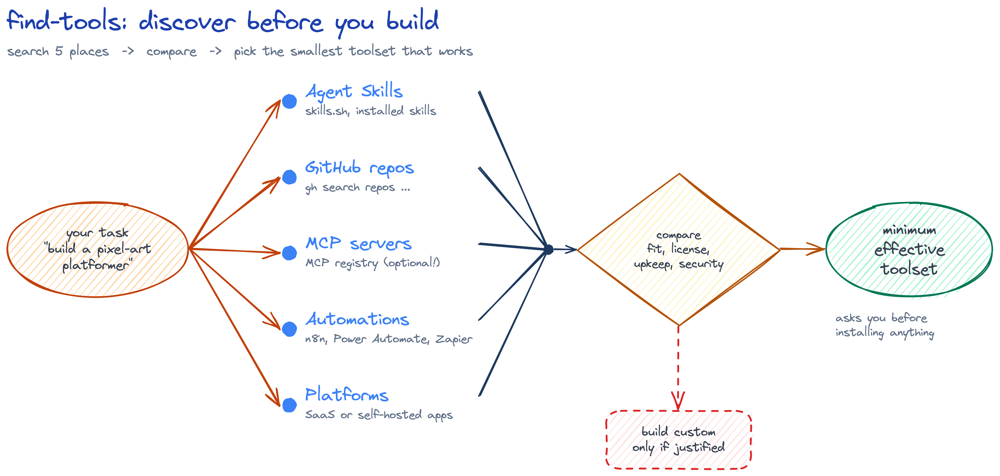
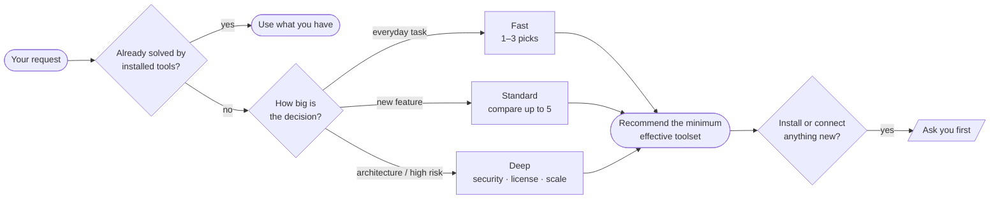

# 🔍 find-tools — discover before you build

An agent-agnostic skill (Claude Code, OpenAI Codex, OpenCode and other agents that support the `SKILL.md` format) that researches existing Agent Skills, GitHub repos, MCP servers, automation templates and platforms **before** building from scratch, then recommends the minimum effective toolset.

**Use it when you say…** "Is there a library for…?", "Find tools to build…", "Compare n8n vs Power Automate"

<p align="center">
  
</p>

## How it picks a research mode



- **Three research modes** — *Fast* (1–3 picks), *Standard* (compare up to 5, default) and *Deep* (security, licensing, scalability review).
- Searches five categories: Agent Skills, GitHub projects, MCP servers, automation workflows (n8n, Power Automate, Make, Zapier) and existing platforms.
- Treats MCP as **optional**, never installs anything without authorization, and never pretends a live search happened when it didn't.

## Installation

This repo *is* the skill folder (`SKILL.md` at the root), so clone it straight into your agent's skills directory.

**Claude Code** (personal, every project):

```bash
git clone https://github.com/TMFPink/find-tools.git ~/.claude/skills/find-tools
```

Or per project: clone into `<project>/.claude/skills/find-tools`.

**OpenAI Codex**:

```bash
git clone https://github.com/TMFPink/find-tools.git ~/.codex/skills/find-tools
```

**Other agents**: place this folder wherever your agent loads `SKILL.md` skills from.

Then describe the task — the agent picks the skill from its `description` — or call it by name (`/find-tools` in Claude Code, `$find-tools` in Codex).

## Requirements

Nothing required. Uses web search, `gh`, or `npx skills` when available.

## Repository layout

```
find-tools/
├── SKILL.md
├── README.md
├── LICENSE
└── assets/
    ├── find-tools-flow.excalidraw   # editable source (open in excalidraw.com)
    └── find-tools-flow.png
```

## Contributing

Issues and pull requests are welcome — improvements to wording, new safety checks, or support notes for other agents.

## License

[MIT](LICENSE) — free to use, modify and share.
